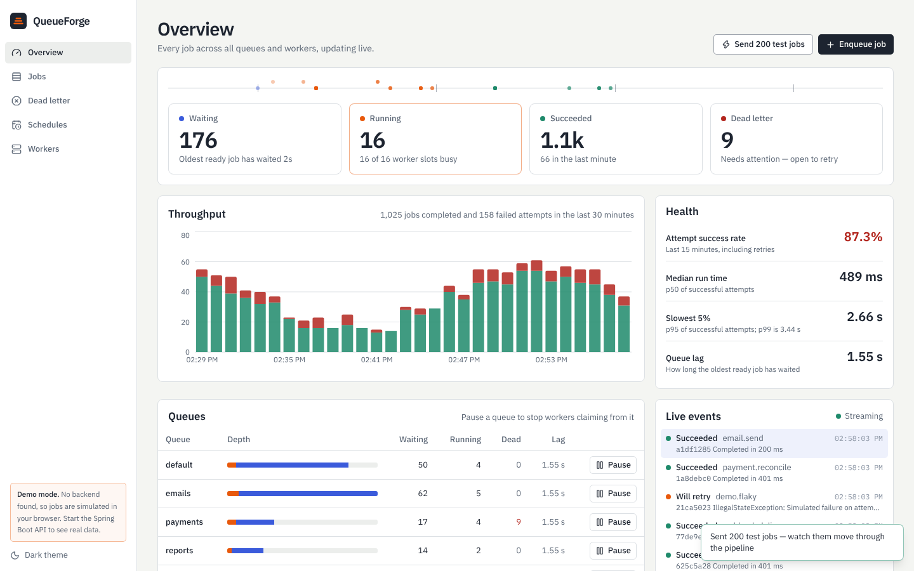

# QueueForge

A background job queue and scheduler — think a mini Sidekiq / SQS — with a live React dashboard, built on Spring Boot (Java 21) and PostgreSQL.

Apps hand it jobs (send an email, generate a report, resize an image...) and QueueForge runs them reliably: no job is ever picked up by two workers at once, failed jobs retry automatically, permanently-failing jobs land in a dead-letter queue, and a crashed worker's jobs get recovered on their own.



## Features

- **Safe concurrent processing** — any number of servers can share the same job queue with zero duplicate work, verified by a test that races 8 workers over 500 jobs
- **Automatic retries** with exponential backoff, and a dead-letter queue for jobs that fail for good
- **Crash recovery** — if a worker dies mid-job, the job is detected and re-queued automatically
- **Duplicate-safe submission** via an idempotency key, so retried requests never create duplicate jobs
- **Cron scheduling** for recurring jobs, guaranteed to fire exactly once even across multiple servers
- **Live dashboard** — queue depth, throughput, latency, worker status, all updating in real time
- **Pause / resume queues**, priorities, full per-job attempt history
- **Docker Compose** for local development, **Terraform** for deploying to AWS (ECS Fargate + RDS)

## Tech stack

**Backend:** Java 21, Spring Boot 3, PostgreSQL, Flyway, Maven
**Frontend:** React 18, Vite, Tailwind CSS, Server-Sent Events
**Infra:** Docker, Terraform, AWS (ECS Fargate, RDS, ALB), GitHub Actions CI/CD

## Run it locally

**Option 1 — everything in Docker**

```bash
docker compose up --build
```

Open the dashboard at `http://localhost:3000` and click **Send 200 test jobs** to watch it work.

**Option 2 — development mode**

Requires Java 21, Maven 3.9+, Node 20+, and PostgreSQL running locally.

```bash
cd backend
mvn spring-boot:run        # API on http://localhost:8080

cd ../frontend
npm install
npm run dev                # Dashboard on http://localhost:5173
```

No backend running? The dashboard automatically falls back to a built-in **demo mode** that simulates everything in the browser — handy for showing it off with nothing set up.

## Project structure

```
backend/        Spring Boot service (API, worker engine, scheduler)
frontend/       React + Tailwind dashboard
infra/terraform/  AWS infrastructure as code
.github/workflows/  CI and deploy pipelines
```

## Want the deep dive?

See [`docs/ARCHITECTURE.md`](docs/ARCHITECTURE.md) for how job claiming and crash recovery actually work under the hood, the full API reference, test strategy, and AWS deployment steps.
