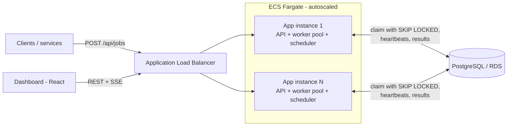
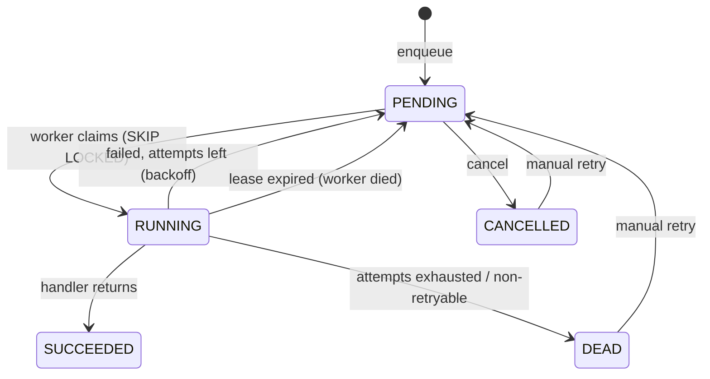

# QueueForge — Architecture Deep Dive

This document has the internals: how jobs are claimed safely, how crash recovery works, the full API, test strategy, and deployment details. See the main [README](../README.md) for a quick overview and setup.

## Architecture



Every instance runs the same jar: the REST API, a worker pool and the cron scheduler. PostgreSQL is the single source of truth. There is no separate broker to operate, and enqueueing a job can share a transaction with the business data that caused it.

### Job lifecycle



### How the key parts work

**Claiming.** Each worker polls with one statement:

```sql
WITH next AS (
  SELECT id FROM jobs
  WHERE status = 'PENDING' AND run_at <= now() AND <queue not paused>
  ORDER BY priority DESC, run_at
  LIMIT :freeThreads
  FOR UPDATE SKIP LOCKED
)
UPDATE jobs SET status = 'RUNNING', attempts = attempts + 1,
                locked_by = :worker, locked_until = now() + :lease
FROM next WHERE jobs.id = next.id
RETURNING jobs.*;
```

`SKIP LOCKED` makes concurrent workers skip rows another transaction has already locked instead of waiting on them, so N workers claim N disjoint batches with no application-level locking. A partial index on `(priority DESC, run_at) WHERE status = 'PENDING'` keeps the scan small as the table grows. Workers only claim as many jobs as they have free threads, so nothing sits claimed but idle.

**Crash recovery.** A claimed job carries a lease (`locked_until`). The worker extends leases for its running jobs every 10 seconds. If a worker crashes, its leases expire and the `LeaseReaper` puts those jobs back to `PENDING`. Every state change is guarded by `WHERE locked_by = :me AND attempts = :attempt`. That acts as a fencing token: a slow worker that comes back after losing its lease updates zero rows, and its stale result is discarded.

**Delivery guarantee.** At-least-once. A job is marked done only after its handler returns, so a crash between "work done" and "marked done" means the job runs again. Handlers are therefore written to be idempotent, which is the same trade-off SQS, Sidekiq and Celery make.

**Retries.** Delay is `min(max, base × 2^(attempt−1)) ± 20% jitter`. The jitter keeps a fleet of failed jobs from retrying in lockstep and hammering a recovering dependency. A handler throws `NonRetryableJobException` for errors retrying can't fix (bad input), and the job is dead-lettered immediately.

**Idempotent enqueue.** `INSERT … ON CONFLICT (idempotency_key) DO NOTHING RETURNING *`. If nothing is returned, the existing job is fetched and the API answers `200` instead of `201`. This is race-free because the unique index does the arbitration.

**Cron.** Due schedules are locked with `FOR UPDATE SKIP LOCKED` inside a transaction that also enqueues the job and advances `next_run_at`. The job's idempotency key is `schedule:{id}:{fireTime}`, so one tick can never produce two jobs, even across instances or retries.

## API

| Method | Path | Purpose |
|---|---|---|
| `POST` | `/api/jobs` | Enqueue a job (`Idempotency-Key` header optional). `201` new, `200` duplicate |
| `GET` | `/api/jobs?status=&queue=&type=&q=&page=&size=` | Search jobs |
| `GET` | `/api/jobs/{id}` | Job with full attempt history |
| `POST` | `/api/jobs/{id}/cancel` | Cancel a pending job |
| `POST` | `/api/jobs/{id}/retry` | Re-queue a dead or cancelled job |
| `POST` | `/api/jobs/dead/retry-all?queue=` | Re-queue the dead-letter queue |
| `GET` | `/api/queues` · `POST /api/queues/{name}/pause` · `/resume` | Queue depth and control |
| `GET/POST/PUT/DELETE` | `/api/schedules` | Cron schedules (`/{id}/trigger`, `/enable`, `/disable`, `/preview?cron=`) |
| `GET` | `/api/stats` | Dashboard metrics |
| `GET` | `/api/workers` | Live worker instances |
| `GET` | `/api/events` | Server-Sent Events stream of job lifecycle events |
| `POST` | `/api/demo/burst?count=` | Load generator |

Example:

```bash
curl -X POST localhost:8080/api/jobs \
  -H 'Content-Type: application/json' -H 'Idempotency-Key: order-1042-email' \
  -d '{"type":"email.send","queue":"emails","payload":{"to":"a@example.com","template":"welcome"},"priority":5}'
```

### Adding a job type

```java
@Component
public class InvoicePdfHandler implements JobHandler {
    public String type() { return "invoice.pdf"; }

    public void handle(JobContext ctx) throws Exception {
        String invoiceId = ctx.payload().path("invoiceId").asText();
        if (invoiceId.isEmpty()) throw new NonRetryableJobException("invoiceId is required");
        // ... generate and upload the PDF (must be safe to run twice)
    }
}
```

## Tests

```bash
cd backend && mvn verify
```

- `BackoffPolicyTest`: exponential growth, cap, jitter bounds, invalid configuration
- `QueueSemanticsTest` (Testcontainers, real PostgreSQL 16):
  - 8 workers released simultaneously against 500 jobs: every job claimed exactly once
  - higher priority claimed first; paused queues skipped
  - duplicate idempotency key returns the original job
  - a stale worker cannot complete a job it no longer owns (fencing)
  - an expired lease on the last attempt dead-letters the job

Integration tests need Docker; without it they are skipped automatically.

## Deploy to AWS

```bash
cd infra/terraform
terraform init

# 1. Create the image repositories first
terraform apply -target=aws_ecr_repository.backend -target=aws_ecr_repository.frontend

# 2. Build and push images (or let the GitHub Actions deploy workflow do it)
REGISTRY=<account>.dkr.ecr.ap-south-1.amazonaws.com
aws ecr get-login-password | docker login --username AWS --password-stdin $REGISTRY
docker build -t $REGISTRY/queueforge-backend:latest ../../backend && docker push $REGISTRY/queueforge-backend:latest
docker build -t $REGISTRY/queueforge-frontend:latest ../../frontend && docker push $REGISTRY/queueforge-frontend:latest

# 3. Everything else
terraform apply
terraform output dashboard_url
```

What gets created: a VPC with public, private and database subnets; RDS PostgreSQL (encrypted, private); ECS Fargate services for the API/workers and the dashboard; an ALB routing `/api/*` to Spring Boot and everything else to nginx; the DB password in Secrets Manager (never in task definitions); CloudWatch logs; and target-tracking autoscaling. Adding tasks adds workers that claim from the same queue with no coordination needed.

**Cost note:** RDS, the NAT gateway and the ALB are billed hourly. Run `terraform destroy` when you're done demoing.

For CD, add an IAM role trusted for GitHub OIDC as the `AWS_DEPLOY_ROLE_ARN` repository secret. Every green build on `main` then builds, pushes and rolls out a new version, and the ECS circuit breaker rolls back automatically if health checks fail.

## Design decisions and trade-offs

- **PostgreSQL instead of Kafka, RabbitMQ or Redis.** One fewer system to run, transactional enqueue alongside business data, and queryable job history. The trade-off is throughput: a Postgres queue comfortably handles thousands of jobs per second, but at very high volume a dedicated broker wins.
- **Polling instead of push.** Simple and robust. Each idle instance runs one indexed query every 500 ms. `LISTEN/NOTIFY` could cut pickup latency further (see roadmap).
- **At-least-once, not exactly-once.** Exactly-once across a crash boundary isn't achievable without idempotent consumers, so the system makes that requirement explicit.
- **JdbcTemplate over JPA.** Queue semantics depend on precise SQL (`SKIP LOCKED`, `ON CONFLICT`, guarded `UPDATE`s), so the SQL is written and reviewed directly.

## Roadmap

- `LISTEN/NOTIFY` wake-ups for sub-100 ms pickup latency
- Per-queue concurrency limits and rate limiting
- Job dependencies (run B after A succeeds)
- Retention job to archive finished jobs older than N days
- Authentication for the dashboard and API
